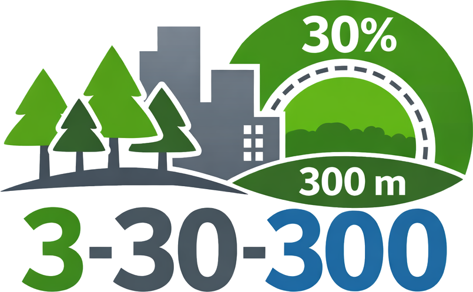

# 3-30-300-index

This repository focuses on the geospatial implementation of the 3-30-300 framework for assessing access to urban greenery and nature-based solutions. 
It explores spatial indicators related to tree visibility, canopy coverage, and proximity to green spaces, combining open geospatial data and reproducible workflows to support urban analysis, comparison across cities, and transparent methodological development.
